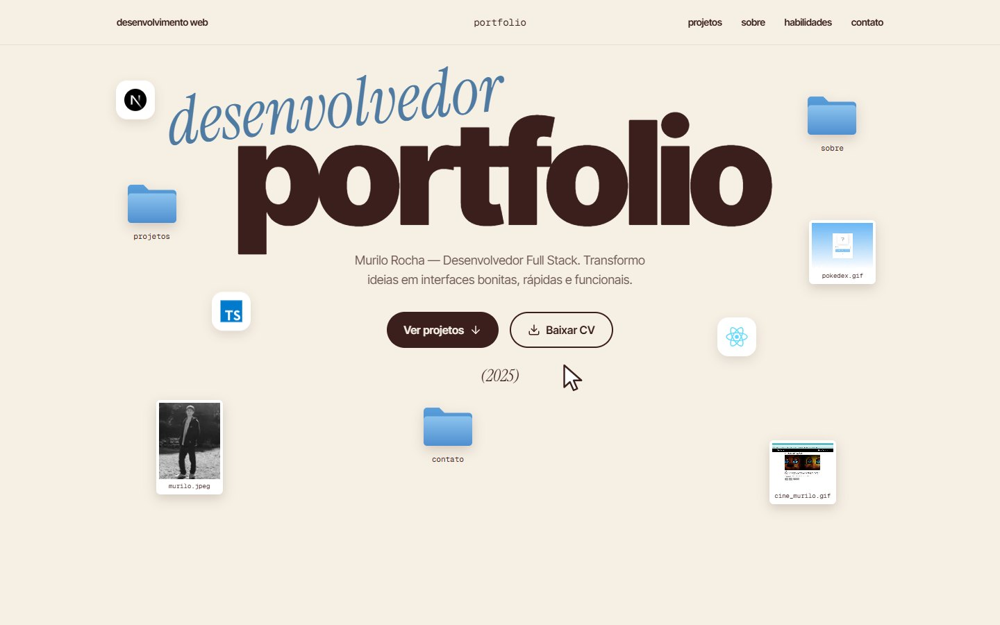
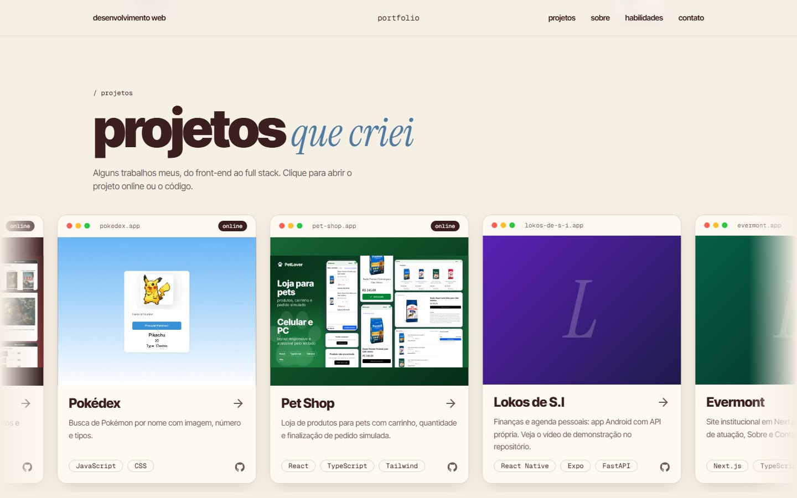
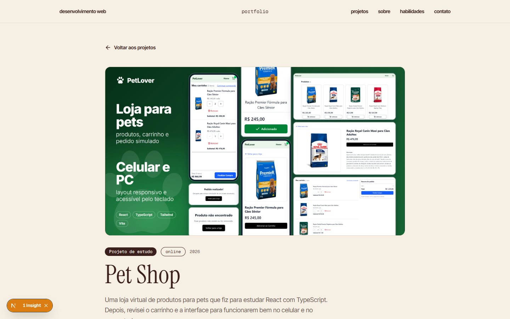
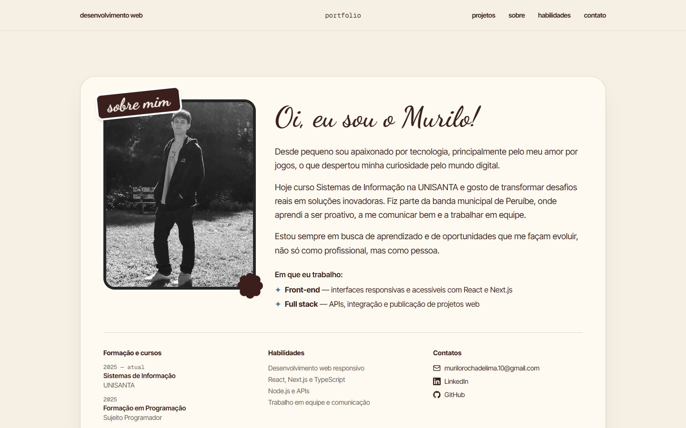

<h1 align="center">💼 Portfólio · Murilo Rocha</h1>

<p align="center"><em>Desenvolvedor Full Stack: projetos, habilidades e contato.</em></p>

<p align="center">
  
</p>

<p align="center">
  <a href="https://oficial-portifolio-six.vercel.app"><strong>🔗 Ver online</strong></a> ·
  <a href="#-sobre">Sobre</a> · <a href="#-funcionalidades">Funcionalidades</a> · <a href="#-tecnologias">Tecnologias</a> · <a href="#-como-rodar">Como rodar</a> · <a href="#-contato">Contato</a>
</p>

<p align="center">
  
  
  
  
</p>

---

## 💻 Sobre

Meu portfólio pessoal, feito para me apresentar como desenvolvedor Full Stack. Reúne um carrossel animado com os meus projetos, uma página de detalhes para cada um (com as dores que resolve, as tecnologias usadas e o que aprendi), uma seção sobre mim, as minhas habilidades e formas de contato.

É a nova versão do site que eu tinha antes em HTML, CSS e JavaScript puro. O histórico da versão antiga continua neste repositório.

> **Tipo:** projeto pessoal · **Ano:** 2026 · **Online:** [oficial-portifolio-six.vercel.app](https://oficial-portifolio-six.vercel.app)

## ✨ Funcionalidades

- Carrossel infinito de projetos, que para quando o mouse ou o foco do teclado está nele.
- Página de detalhes para cada projeto, em `/projetos/[slug]`.
- Visual de "área de trabalho": pastas, janelas e ícones de aplicativos.
- Seções de Sobre mim (com formação e cursos), Habilidades e Contato.
- Textos e projetos em um arquivo só (`src/data/site.ts`), fácil de atualizar.
- Responsivo, com menu para celular, foco visível no teclado e respeito à preferência de reduzir animações.

## 💼 Tecnologias


| Tecnologia | Para que usei |
| --- | --- |
| **Next.js 16** | Páginas, rotas (App Router) e build. |
| **React 19** | Interface em componentes. |
| **TypeScript** | Tipagem dos dados e dos componentes. |
| **Tailwind CSS 4** | Estilo e layout responsivo. |
| **Motion** | Animações de entrada das seções. |
| **Lucide React** | Ícones. |
| **Vercel** | Publicação do site. |

## 📸 Telas

<table>
  <tr>
    <td width="33%" align="center" valign="top"><br /><sub>Carrossel de projetos</sub></td>
    <td width="33%" align="center" valign="top"><br /><sub>Detalhes de um projeto</sub></td>
    <td width="33%" align="center" valign="top"><br /><sub>Sobre mim</sub></td>
  </tr>
</table>

## 🚀 Como rodar

Precisa do Node.js e do npm instalados.

```bash
git clone https://github.com/MuriloRocha-01/Oficial-Portif-lio.git
cd Oficial-Portif-lio
npm install
npm run dev        # http://localhost:3000
```

Para publicar uma versão de produção: `npm run build` e `npm start`.

## ✏️ Como editar o conteúdo

O texto do site fica em `src/data/`, separado do visual. Não precisa mexer nos componentes para trocar conteúdo.

| Quero mudar… | Edite |
| --- | --- |
| Meu nome, textos do "sobre", e-mail e links | `src/data/profile.ts` |
| Ícones de habilidades | `src/data/skills.ts` |
| Formação e cursos | `src/data/milestones.ts` |
| Um projeto existente | `src/data/projects/<nome-do-projeto>.ts` |
| Decisões técnicas de um projeto | campo `decisoes` do arquivo do projeto (problema, o que fiz, resultado) |
| Mover um projeto entre "projetos" e "estudos" | campo `tipo: "estudo"` no arquivo do projeto |

**Para adicionar um projeto:** copie um arquivo de `src/data/projects/`, troque os dados, coloque a capa em `public/projects/` e inclua o projeto na lista de `src/data/projects/index.ts` (a ordem da lista é a ordem do carrossel). A página `/projetos/<slug>` é criada sozinha.

## 🔎 Buscadores e compartilhamento (SEO)

Tudo que o Google, o WhatsApp e o LinkedIn leem fica em poucos lugares:

| O quê | Onde |
| --- | --- |
| Endereço do site, título, descrição e imagem padrão | `src/data/seo.ts` (ao trocar de domínio, mude só `siteUrl`) |
| Metadados de todas as páginas | `src/app/layout.tsx` |
| Metadados de cada projeto (título, canonical e capa) | `src/app/projetos/[slug]/page.tsx` |
| Imagem do cartão de compartilhamento (1200 × 630) | `public/og-image.jpg` |
| `robots.txt` e `sitemap.xml` (gerados sozinhos) | `src/app/robots.ts` e `src/app/sitemap.ts` |
| Dados estruturados (quem sou eu, GitHub e LinkedIn) | `src/lib/structuredData.ts` |

## 🗂 Estrutura do projeto

```text
src/
├─ app/                  rotas: página inicial (page.tsx), /projetos/[slug], layout e estilos globais
├─ components/
│  ├─ layout/            Header e Footer, presentes em todas as páginas
│  ├─ sections/          blocos da página inicial: Hero, ProjectsSection, About, SkillsSection, Contact
│  ├─ projects/          card, carrossel, capa e página de detalhe dos projetos
│  ├─ decor/             enfeites em SVG: Folder, Cursor, AppTile, Flower
│  └─ ui/                peças reutilizáveis: Reveal, SectionTitle, estilos de botão e ícones de marca
├─ data/                 todo o conteúdo: profile, skills, milestones, projects/ e os tipos (types.ts)
└─ lib/                  funções auxiliares (slugify)
public/projects/         capas dos projetos
vercel.json              define o framework Next.js na Vercel
```

Regra de leitura: `app/` só monta a página, `components/` desenha, `data/` guarda os textos.

## 🧭 Próximos passos

- [ ] Vídeo de demonstração e capa para o Lokos de S.I
- [ ] Trocar os GIFs pesados do início e da Pokédex por vídeo curto

## 📬 Contato

Disponível para freelas e novas oportunidades, **#OpenToWork** 🚀  
📧 [murilorochadelima.10@gmail.com](mailto:murilorochadelima.10@gmail.com) · 💼 [LinkedIn](https://www.linkedin.com/in/murilo-rocha-6706a41aa/) · 🐙 [GitHub](https://github.com/MuriloRocha-01) · 🌐 [Portfólio](https://oficial-portifolio-six.vercel.app)

## 🏆 Licença

Distribuído sob a [licença MIT](./LICENSE).

---

<p align="center">Feito com 💙 por <a href="https://github.com/MuriloRocha-01">Murilo Rocha</a></p>
